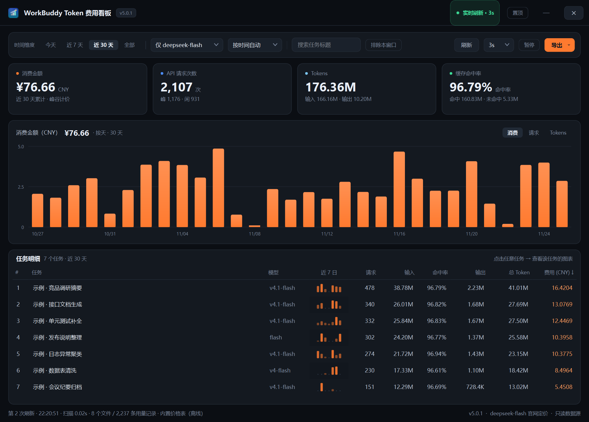

# WorkBuddy Token 费用看板

读取本机 WorkBuddy 的会话日志，按 DeepSeek 官方峰谷价格把 token 用量折算成人民币费用，
提供深色图形看板与命令行报表。**只读本地文件，不登录、不上传、不修改任何 WorkBuddy 数据。**



> 非官方工具，与 WorkBuddy、DeepSeek 无隶属或背书关系。费用为估算值，最终以官方账单为准。

## 功能特性

- **只读采集**：解析 `~/.workbuddy/projects/*/*.jsonl` 的 `providerData.rawUsage`，
  会话标题取自 `workbuddy.db` 的 `sessions` 表，数据库以 `mode=ro` 打开。
- **峰谷计价**：工作日的 9:00–12:00、14:00–18:00（北京时间）按高峰价，其余时段、
  周末与指定节假日按闲时价；也可强制全高峰 / 全闲时。
- **图形看板**：KPI 卡片、消费/请求/Tokens 三指标切换、按小时或按天的柱状/面积图、
  任务明细表与近 7 日迷你柱。
- **任务下钻**：点击任意任务行，打开该任务独立图表窗口（今天按小时、历史按天）。
- **多维筛选**：时间维度、模型范围、峰谷模式、标题搜索、排除当前活跃窗口。
- **导出**：逐会话 CSV、含每日/分时聚合的 JSON。
- **实时刷新**：默认 3 秒重扫，可调间隔、暂停、置顶；后台线程扫描不卡界面。
- **离线兜底**：官网价格页不可达时回落到内置价格表，并明确标注来源。
- **去重**：同一 `messageId` 只计一次，避免日志重放导致重复计费。

## 系统要求

| 使用方式 | 要求 |
|---|---|
| 预编译版 | Windows 10 1809+ / Windows 11，x64；无需安装 Python |
| 源码运行 | Python 3.10+，PySide6-Essentials 6.12；Windows 为主，macOS/Linux 未验证 |
| 数据源 | 本机使用过 WorkBuddy，存在 `~/.workbuddy/projects` 目录 |

## 安装

### 方式一：安装包（推荐）

1. 从 Releases 下载 `WorkBuddyTokenCost-<版本>-win64.zip` 并解压。
2. 双击 `installer\install.cmd`。
3. 安装完成后，桌面与开始菜单会出现快捷方式。

安装器为**按用户安装，不需要管理员权限**，默认写入
`%LOCALAPPDATA%\Programs\WorkBuddyTokenCost`。详细参数、静默安装与卸载说明见
[docs/INSTALL.md](docs/INSTALL.md)。

### 方式二：绿色版

直接运行压缩包内的 `WorkBuddyTokenCost.exe`（GUI）或
`WorkBuddyTokenCost_CLI.exe`（命令行），不写注册表、不创建快捷方式。

### 方式三：从源码运行

```powershell
python -m venv .venv
.\.venv\Scripts\Activate.ps1
python -m pip install -r requirements.txt

python gui_app.py                     # 图形界面
python token_cost.py --once --no-pause  # 一次性命令行报表
```

## 卸载

优先使用 Windows「设置 → 应用 → 已安装的应用 → WorkBuddy Token Cost → 卸载」，
或运行安装目录下的 `uninstall.ps1` / 压缩包内的 `installer\uninstall.cmd`。

静默卸载：

```powershell
powershell -NoProfile -ExecutionPolicy Bypass -File .\installer\uninstall.ps1 -Silent
```

卸载会移除程序文件、快捷方式、可选的 PATH 条目与卸载注册项；不触碰 `~/.workbuddy`。

## 使用方法

### 图形界面

| 区域 | 说明 |
|---|---|
| 顶部筛选条 | 时间维度、模型范围（仅 flash / 含 v4-pro / 全部模型估算）、峰谷模式、标题搜索、排除本窗口 |
| KPI 卡片 | 消费金额、API 请求次数、Tokens、缓存命中率；随所选范围联动 |
| 主图表 | 消费 / 请求 / Tokens 切换；「今天」按小时，其余按天 |
| 任务明细 | 点击表头排序，点击行打开该任务的独立图表窗口 |
| 底部状态栏 | 刷新轮次、扫描耗时、文件/记录数、价格来源 |
| 导出 | 右上角「导出」，可选 CSV 或 JSON |

常用参数：

```powershell
python gui_app.py --root "D:\data\.workbuddy" --range 30d --metric cost
python gui_app.py --detail 某个任务关键词        # 启动后直接打开该任务窗口
python gui_app.py --offline --topmost            # 不联网取价 + 窗口置顶
```

### 命令行

不传 `--once` 时默认进入实时刷新（每 3 秒），`Ctrl+C` 退出。

```powershell
WorkBuddyTokenCost_CLI.exe --once --top 0                 # 全部会话，一次性报表
WorkBuddyTokenCost_CLI.exe --watch 1 --title 交接          # 每秒刷新，只看标题含“交接”
WorkBuddyTokenCost_CLI.exe --once --peak all --csv out.csv # 全按高峰价并导出
WorkBuddyTokenCost_CLI.exe --once --offline --json out.json
```

| 参数 | 默认 | 说明 |
|---|---|---|
| `--root PATH` | `~/.workbuddy` | 数据根目录，需包含 `projects` 子目录；支持相对路径 |
| `--title TEXT` | 空 | 只统计标题包含该关键词的会话 |
| `--all-models` | 关 | 纳入所有模型（仍按 flash 价估算，报表标注） |
| `--include-pro` | 关 | 纳入 `deepseek-v4-pro`（官网说明其按 flash 计费） |
| `--exclude-current` | 关 | 排除 `sessions/*.json` 中的当前活跃窗口 |
| `--peak auto\|all\|off` | `auto` | 按时间判峰谷 / 全高峰 / 全闲时 |
| `--since YYYY-MM-DD` | 空 | 起始日期（含） |
| `--until YYYY-MM-DD` | 空 | 结束日期（含） |
| `--holidays 日期,...` | 空 | 法定节假日，这些日期按闲时计价 |
| `--offline` | 关 | 不联网，直接使用内置价格表 |
| `--top N` | 20 | 表格显示前 N 个会话，0 为全部 |
| `--watch [SEC]` | 3 | 实时刷新间隔 |
| `--once` | 关 | 只扫描一次后退出 |
| `--count N` | 0 | 实时模式重扫 N 次后退出，0 为持续 |
| `--price-refresh SEC` | 600 | 实时模式下重新拉取官网价格的间隔 |
| `--csv PATH` / `--json PATH` | 空 | 导出逐会话明细 / 汇总结果 |
| `--list` | 关 | 只列出会话，不计算金额 |
| `--pause` / `--no-pause` | 自动 | 结束前是否等待回车 |

### 计价口径

- 单位：人民币元 / 百万 tokens，顺序为（缓存命中输入、缓存未命中输入、输出）。
- 内置价表（离线兜底）：

  | 时段 | 命中输入 | 未命中输入 | 输出 |
  |---|---|---|---|
  | 闲时 | 0.02 | 1.00 | 4.00 |
  | 高峰 | 0.04 | 2.00 | 8.00 |

- 高峰时段：北京时间工作日 9:00–12:00、14:00–18:00；周末与 `--holidays` 指定日期为闲时。
- 默认只统计 flash 系列（`deepseek-flash`、`deepseek-v4.1-flash`、`deepseek-v4-flash`、
  `deepseek-v4-flash-vision-exp`）；其他模型默认排除并在报表中列出。
- 联网时会校验官网价格结构（闲时:高峰 = 1:2、数值为正且递增），校验失败即回落内置表。

### 数据与隐私

- 程序只读 `~/.workbuddy`，不写入、不上传；无遥测、无账号体系。
- 会话标题可能包含敏感信息；导出的 CSV/JSON 会带上标题，分享前请自行脱敏。
- 仓库内的截图由 `scripts/make_demo_data.py` 生成的合成数据拍摄，不含真实会话。

## 目录结构

```text
.
├── assets/                      # 应用图标与尺寸预览
│   └── design/                  # 图标迭代与原始截图（本地保留，已忽略）
├── docs/                        # 审计报告、安装说明、截图
│   └── images/
├── installer/                   # PowerShell 安装 / 卸载程序
├── scripts/                     # 图标生成、演示数据、开发启动器
├── tests/                       # pytest 单元测试
├── .github/workflows/           # CI 与 Release
├── token_cost.py                # 核心：采集、计价、聚合、报表、导出
├── gui_app.py                   # PySide6 看板
├── WorkBuddyTokenCost.spec      # GUI 打包配置
├── WorkBuddyTokenCost_CLI.spec  # CLI 打包配置
├── version_info.txt             # Windows 版本资源
├── build.ps1                    # 构建 + 校验和 + Release zip
├── build.cmd                    # build.ps1 的双击包装（绕过执行策略）
├── pyproject.toml
├── requirements.txt
├── requirements-dev.txt
├── CHANGELOG.md
├── CONTRIBUTING.md
├── SECURITY.md
└── LICENSE
```

各目录的版本控制边界见 [docs/REPOSITORY.md](docs/REPOSITORY.md)。

## 项目文档

| 文档 | 内容 |
|---|---|
| [docs/INSTALL.md](docs/INSTALL.md) | 安装器参数、安装足迹、静默部署、卸载与排错 |
| [docs/AUDIT.md](docs/AUDIT.md) | 死引用、未使用依赖、断链路径、冗余注释的审计记录 |
| [docs/SECURITY-AUDIT.md](docs/SECURITY-AUDIT.md) | 威胁边界、风险分级、修复与残余风险 |
| [docs/REPOSITORY.md](docs/REPOSITORY.md) | 文件分类、忽略规则、分支与发布约定 |

## 开发与构建

```powershell
python -m pip install -r requirements-dev.txt
python -m pytest -q
python -m pyflakes token_cost.py gui_app.py scripts tests

python scripts/make_demo_data.py --force      # 生成 demo-data/ 合成数据
python gui_app.py --root demo-data --offline  # 用合成数据调试

.\build.cmd                                   # 构建两个 exe、SHA256SUMS 与 zip（自动绕过执行策略）
.\build.cmd -SkipTests -CliOnly               # 只构建 CLI
.\build.ps1 -Python C:\Python313\python.exe   # 直接跑 ps1 时，可指定解释器
```

构建产物在 `dist/`，中间文件在 `build/`，均不纳入版本控制。

## 贡献

欢迎提交 Issue 与 Pull Request。开始之前请阅读 [CONTRIBUTING.md](CONTRIBUTING.md)。
安全问题请按 [SECURITY.md](SECURITY.md) 私下报告，不要开公开 Issue。

## 许可证

[MIT](LICENSE)。

WorkBuddy、DeepSeek 等名称与商标归各自所有者，本项目仅作兼容性说明使用。
